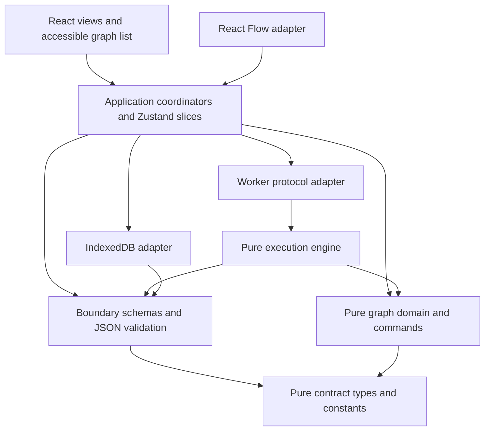

# Architecture

## Authority and dependency direction

One canonical immutable `WorkflowDocument` in the application document session is the source of graph truth. IndexedDB holds durable snapshots; it is not live editor state. React Flow receives a projection of that document plus transient interaction overlays. The worker receives a frozen snapshot tied to the active session and semantic revision. Neither projection nor worker may mutate the canonical document.



Arrows mean may depend on. `domain` and `contracts` MUST NOT import React, React Flow, Zustand, browser APIs, storage, or application coordinators. Domain validation operates on typed data; Zod is a boundary adapter in `validation`. The engine MAY use pure data validators but MUST NOT import UI, stores, persistence, or DOM. Browser timing/ID creation are injected ports. No cross-feature import through UI internals and no circular imports.

## Proposed source layout (not created by this blueprint)

```text
src/
  contracts/           workflow/node/run/error types; named limits
  domain/graph/        indexes, invariants, traversal, command reducer, history
  domain/json/         own-property paths, immutable JSON transforms, canonical form
  validation/          Zod schemas, bounded JSON/import validation, readiness checks
  engine/             compile, scheduler, node handlers, event reducer
  application/        document session, command dispatch, run coordinator, save queue
  state/              vanilla Zustand stores, slices, narrow selectors
  adapters/react-flow/ projection and intent translation, custom node views
  adapters/persistence/ IndexedDB operations, CAS, checksum, migrations
  adapters/worker/     module worker entry, message schemas, lifecycle bridge
  features/workflows/  document list, import/export dialogs
  features/editor/     canvas, palette, inspector, connection dialog, graph list
  features/execution/  runtime controls, results, diagnostics
  ui/                  semantic primitives, tokens, shell, error boundary
  app/                 composition root and boot capability checks
tests/
  fixtures/ unit/ integration/ e2e/ security/ accessibility/ performance/
```

Do not create empty abstractions to satisfy this tree. Add modules when their owning stage implements behavior. Aliases MUST express these boundaries; lint import restrictions and an architecture test MUST enforce forbidden directions from Stage 1.

## Responsibilities

| Module | Input / output | Must not own |
| --- | --- | --- |
| Domain | Typed document + command -> candidate or structured error | Browser interaction, async saving |
| Validation | `unknown`/bounded bytes -> validated typed data + diagnostics | Repairing data silently |
| Application | User intent -> atomic publication, revision/history updates, async effects | Graph algorithm duplication |
| Rendering adapter | Document + overlays -> controlled nodes/edges; library events -> intents | Persistence or direct graph mutations |
| State | Canonical session and ephemeral slices, narrow subscriptions | Independent graph copies |
| Persistence | Captured snapshots + expected storage revision -> CAS commit result | Undo history, runtime values |
| Engine | Validated snapshot -> ordered immutable results and events | React state or rendering timing |
| Debugging | Validated run events -> bounded per-node view and result inspection | Rescheduling execution |
| Error service | Structured errors -> scoped messages and redacted diagnostics | Raw payload logging |

## Controlled rendering synchronization

Derive React Flow node/edge objects by stable domain ID; memoize unchanged entities. `onConnect`, reconnect, delete, and final movement callbacks dispatch domain commands. Selection, measured sizes, hover, and in-progress drag positions enter ephemeral slices only. React Flow change helpers MUST NOT be applied wholesale to the canonical graph; each change category has an explicit translation. See [commands](GRAPH_COMMANDS.md) and [state](STATE_MANAGEMENT.md).

A drag overlays transient positions on controlled props and commits one `MoveNodes` command at gesture end. Escape rolls back the overlay. Imported documents cannot contain renderer internals. React Flow's `toObject()` MUST NOT be a persistence/export format. Its internal store may retain measurements and interactions, never independent business data. Library keyboard deletion is intercepted so one user intent produces one transaction.

The controlled `nodes`, `edges`, and viewport APIs are documented by [React Flow](https://reactflow.dev/api-reference/react-flow); the choice of single authority and transactional translation is FlowCanvas policy.

## Service flow and cleanup

After a command succeeds, publish document + indexes + history in one synchronous store update, then schedule validation diagnostics and persistence for the captured revision. Errors before publication leave every slice unchanged. Async diagnostics and worker events are accepted only for the matching session/revision. Deleting or switching documents disposes active interactions, cancels workers, flushes or explicitly resolves dirty writes, and clears history as specified by [persistence](PERSISTENCE.md).

Use one IndexedDB adapter with explicit transactions and one worker per active run. Bounded event inspection is derived from worker events; no animation callback controls engine progression. UI error boundaries recover rendering failures without deleting the document. Domain/application errors use [structured taxonomy](ERROR_HANDLING.md).

## Trade-offs and rejected approaches

- A backend adds deployment and confidentiality boundaries without solving initial requirements; rejected for beta.
- React Flow as graph truth would couple persistence and algorithms to renderer internals; rejected.
- A universal plugin architecture and dependency-injection container add speculative flexibility; use explicit module composition instead.
- Event-sourcing all user actions would complicate migrations; bounded immutable history plus canonical snapshots is adequate.
- Workers require message validation and serialization overhead, but allow enforced termination of stalled operations. They are mandatory for Stage 3, not a Stage 1 implementation task.
- Separate Zustand slices improve ownership without separate synchronized graph stores. Full snapshots are bounded; patch-history complexity is deferred until measured evidence demands it.

Architecture is a selected design, not runtime-validated evidence. [Decisions](DECISIONS.md) records changes and [testing](TESTING_STRATEGY.md) defines proof obligations.
