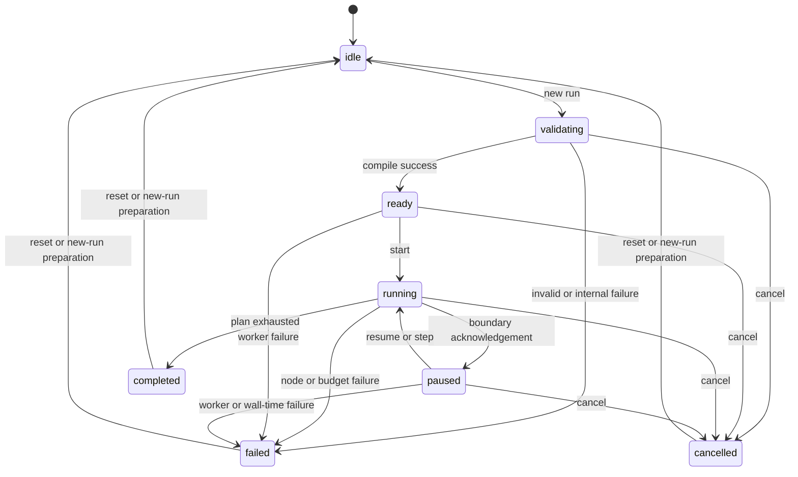

# Deterministic execution model

## Compilation and run identity

Run is explicit and starts **all** Manual Triggers. Capture an immutable document snapshot, fresh UUID runId, sessionId, and semanticRevision. Reject stale readiness results. Validate the full document structurally and apply [readiness rules](GRAPH_SCHEMA.md), then compile in a dedicated module worker: fixed node registry, sorted roots, deterministic topological order, adjacency, trigger reachability, and exact typed configs. Notes never enter the plan. Compilation failure produces structured errors and executes zero nodes.

The engine is pure application logic with injected monotonic clock, cancellation, and ID/context inputs; the worker provides isolation/transport. No dependency on React, React Flow, DOM, storage, animation, or canvas positions. Rendering cannot change scheduling. Config/input snapshot values are immutable for the run.

## State machine



Only diagrammed transitions are allowed, except timeout/internal failure during validating also follows validating -> failed. Cancel is idempotent once terminal; it does not convert completed/failed to cancelled. Duplicate Pause/Resume/Step requests are acknowledged as no-ops or rejected as INVALID_TRANSITION without changing state. No direct idle -> running, paused -> completed without resuming the scheduler, terminal -> running, or running -> ready. New Run from a terminal state clears the prior run, transitions through idle, and assigns a new runId. `ready` may be brief but must be represented and tested.

Validation/readiness failures are `failed` runs with no node results. Editing a semantic dependency cancels a nonterminal run, invalidates the run view, and returns the coordinator to idle; a stale terminal snapshot cannot repopulate it. Presentation-only edits preserve the accepted run.

## Scheduling, activation, and data propagation

Iterate the static topological plan once, in [algorithm order](GRAPH_ALGORITHMS.md). At most one handler is pending. Await sync/promise results uniformly; never use promise settlement to order independent roots.

The worker scheduler MUST yield to its task queue before the first invocation and after every completed operation, and within MAX_SKIPS_BETWEEN_YIELDS skipped records from [data](DATA_CONTRACT.md), then process control/cancellation flags before continuing. Inject an awaitable `yieldControl` port into the pure engine; the worker adapter SHOULD implement a MessageChannel task yield without timer-clamping overhead. Promise-only microtask yielding is insufficient because it can starve incoming control messages. While paused, wait for control without polling or spinning. Yielding may affect timing but never semantic plan order.

1. A trigger is activated without input and emits its configured object.
2. A nontrigger outside all trigger reachability is skipped with `unreachable`.
3. A reachable node whose sole inbound edge did not emit is skipped with `branch-not-selected` if its direct parent Condition chose another port; otherwise `upstream-skipped`.
4. An activated node receives exactly its inbound edge's payload. The output-port map determines active outgoing edges. One emitted value may fan out to many consumers as a shared immutable reference.
5. Condition emits exactly one of true/false. No synthetic null/empty object and no residual value from prior runs enters inactive branches. Because each target has one input, branch convergence and joins are prohibited.
6. Output records its input; every activated Output yields one named result keyed by ID in deterministic order. No activated Output is also possible when routing avoids every statically reachable Output: complete successfully with a `NO_OUTPUT_ACTIVATED` warning and empty final results.

Every executable node receives one terminal disposition in a completed run: completed or skipped. Nonexecutable Notes have no execution record. Multiple trigger roots have independent data, but share the same deterministic serial scheduler and global budgets. Config-null unreachable nodes remain skipped; reachable config-null nodes prevent readiness.

## Pause, resume, step, cancellation

Pause requests set `pauseRequested`; state remains running until the current operation resolves and a boundary is reached. At that boundary check plan exhaustion before honoring Pause: if the plan already finishes, completion wins. Resume clears the pause request and continues. Step is available only while paused: transition to running, process skips until the next activated node, invoke exactly one node, then pause before the next activated node. If that operation exhausts the plan, complete; if only skips remain, consume them and complete without inventing an operation. A Step button from idle is allowed as a convenience: validate -> ready -> running, immediately pause before the first operation, then perform one step. This uses the same state transitions.

Cancellation checks occur before compilation phases, before/after each operation, and before event publication. Host cancels cooperatively, then terminates an unresponsive worker after [grace budget](DATA_CONTRACT.md). Terminal UI follows the foreground completion target. An unresolved handler cannot prevent termination. Active-time and per-operation watchdogs include future async waits; paused time is excluded from active time but included in the total wall deadline. Background timer throttling cannot guarantee real-time deadlines: on visibility return, expired runs MUST fail/terminate before continuation or accepting results.

Measure wall time from the coordinator's initial validating transition to terminal acceptance. `pausedMs` sums acknowledged paused intervals; `activeMs = wallMs - pausedMs`, including validation/compilation/ready/transport waits. `compileMs` is a separately reported subset, not added again. Host-owned monotonic intervals enforce deadlines; do not subtract absolute timestamps from different worker/window time origins. The host per-operation watchdog starts when it accepts node-start and ends when the validated completion/failure is accepted. The worker separately measures invocation-to-resolution duration and rejects over-budget output; no later response can revive a host-timed-out run.

Async node extension policy: no new beta nodes are authorized, but the engine interface accepts promises. Every pending handler must receive cancellation, be awaited, have rejection handling, and produce no accepted event after its run is invalidated. Network/I/O capabilities are still forbidden.

## Results and errors

```ts
type NodeDisposition = 'pending' | 'running' | 'completed' | 'skipped' | 'failed' | 'cancelled';
interface NodeRunRecord {
  readonly nodeId: string;
  readonly disposition: NodeDisposition;
  readonly inputPayloadId?: string;
  readonly outputPayloadIds?: Readonly<Record<string, string>>;
  readonly skipReason?: 'unreachable' | 'branch-not-selected' | 'upstream-skipped' | 'run-failed';
  readonly errorCode?: string;
  readonly durationMs?: number;
}
```

Payload IDs identify bounded run-local immutable objects; they are not persisted workflow IDs. Payload data is stored separately from metadata events. Trigger/transform/Condition emitted bytes count toward cumulative produced bytes even when Condition forwards a reference; retained unique data is counted once. Output reuses the existing payload and creates no new emitted value.

Validate the complete handler result, emitted port set, and budget before publishing any activation. If transport sends payload-record messages before node-complete, the host stages them without showing outputs or activating descendants; commit payload references, node completion, and accounting together only after a valid completion message. Discard staged data on node/run failure or cancellation. An existing payload ID cannot be rebound to different data, and no completion may reference an unknown payload ID.

```ts
interface FinalOutput {
  readonly nodeId: string;
  readonly name: string;
  readonly payloadId: string;
  readonly sequenceIndex: number; // zero-based among activated Outputs
}
interface RunResult {
  readonly runId: string;
  readonly sessionId: string;
  readonly semanticRevision: number;
  readonly status: 'completed' | 'failed' | 'cancelled';
  readonly nodeRecords: readonly NodeRunRecord[]; // static plan order
  readonly outputs: readonly FinalOutput[]; // activated Output order
  readonly partial: boolean; // true iff terminal status is failed/cancelled
  readonly error?: AppError;
  readonly timings: {
    readonly compileMs: number; readonly activeMs: number;
    readonly pausedMs: number; readonly wallMs: number;
  };
  readonly counts: {
    readonly operations: number; readonly completed: number; readonly skipped: number;
    readonly failed: number; readonly cancelled: number; readonly eventsEvicted: number;
  };
}
```

All timing/count fields are finite nonnegative numbers, counts are safe integers, and records/references must agree with the plan and payload registry. Failed results require a structured error; cancellation has a reason/status without pretending to be a node failure. Compile failure may have empty records/outputs. Payload registry contents are scoped to the accepted run and disposed on reset/invalidation; RunResult is not a workflow export format.

Fail fast on first activated handler error, timeout, budget breach, protocol violation, or worker crash. Mark that node failed when known; mark remaining pending nodes skipped with run-failed. Cancellation marks the active and remaining pending nodes cancelled, preserving already completed/skipped records. Retain earlier Output values as **partial results**, clearly labeled with terminal run state. Never present partial output as overall success. Compilation errors have no node dispositions unless node-referenced diagnostics exist.

## Event protocol and measurements

Use versioned strict message unions with `{protocolVersion:1, sessionId, semanticRevision, runId, sequence, kind}`. Each direction has its own sequence beginning at 1; controls carry fresh UUID request IDs and responses acknowledge that request. Host-to-worker kinds are start (document snapshot), begin, pause, resume, step, and cancel. Worker-to-host kinds are ready, state, control-ack (accepted/no-op/rejected with safe code), node-start, payload-record, node-complete, node-skip, node-fail, warning, and terminal (RunResult metadata). Each kind MUST have an exact discriminated schema; messages cannot embed arbitrary actions. Payload messages are individually bounded; event metadata contains only IDs, counts, codes, and numeric timing. No raw payload in logs. [Execution security](EXECUTION_SECURITY.md) owns validation rules.

Begin carries `mode: 'run' | 'pauseBeforeFirst'`. The latter transitions ready -> running -> paused before invoking a node; the coordinator then requests Step after the pause acknowledgement. Node-start is posted before invoking the handler, so the host can arm its independent watchdog even if that handler blocks the worker.

The bounded event ring stores redacted metadata events, not payload-record contents or the full terminal result. FinalOutput display names are validated result data from the captured configuration and are available in the result view, never diagnostic logs. Terminal summaries/results have their own result-envelope bound; record a compact terminal event in the ring.

Sequence numbers are contiguous per worker run; validate before reducing events. Transport batches preserve sequence and are bounded by envelope bytes; UI batching may delay drawing, never reorder records. Ring eviction retains total event counts and an explicit truncated count; final state, Output summaries, and current node records are retained separately within their own payload budget. Forced host termination creates one local terminal event after the last accepted sequence and discards all further worker traffic.

Monotonic timing measures validation/compile, each handler including waits, active execution, paused duration, and total wall time. Durations and run IDs are nondeterministic metadata; semantic outcomes, skip reasons, node ordering, and Output values must be identical for identical documents. Timing is diagnostic, not a scheduler input except deadlines. Test fake clocks for timeout logic and real browser clocks for responsiveness.

## Acceptance

Stage 3 implements this contract in `src/engine`, `src/application/execution.ts` and `src/adapters/worker`. Validate retains ready without beginning operations; Run/Step explicitly begin the compiled plan. The host validates a canonical snapshot before allocating a worker, and the worker independently compiles it. Separate ledger instances validate reduction in each process. UI publication batches metadata without controlling operation order. Current acceptance, measurements and missing evidence are recorded in [the Stage 3 report](reports/STAGE_3_REPORT.md); blueprint-era statements below describe their original evidence boundary.

Verify both Condition routes, multiple roots, fan-out immutability, disconnected nodes, no active Output, failure partial results, step over skipped nodes, pause at completion, cancellation during synthetic unresolved async work, timeout while paused, shuffled serialized order, stale worker responses, and semantic edit invalidation. Run real worker E2E in addition to pure engine tests. No runtime evidence exists at blueprint creation.
